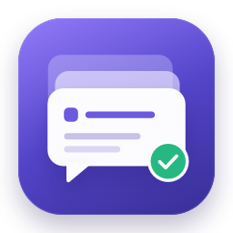
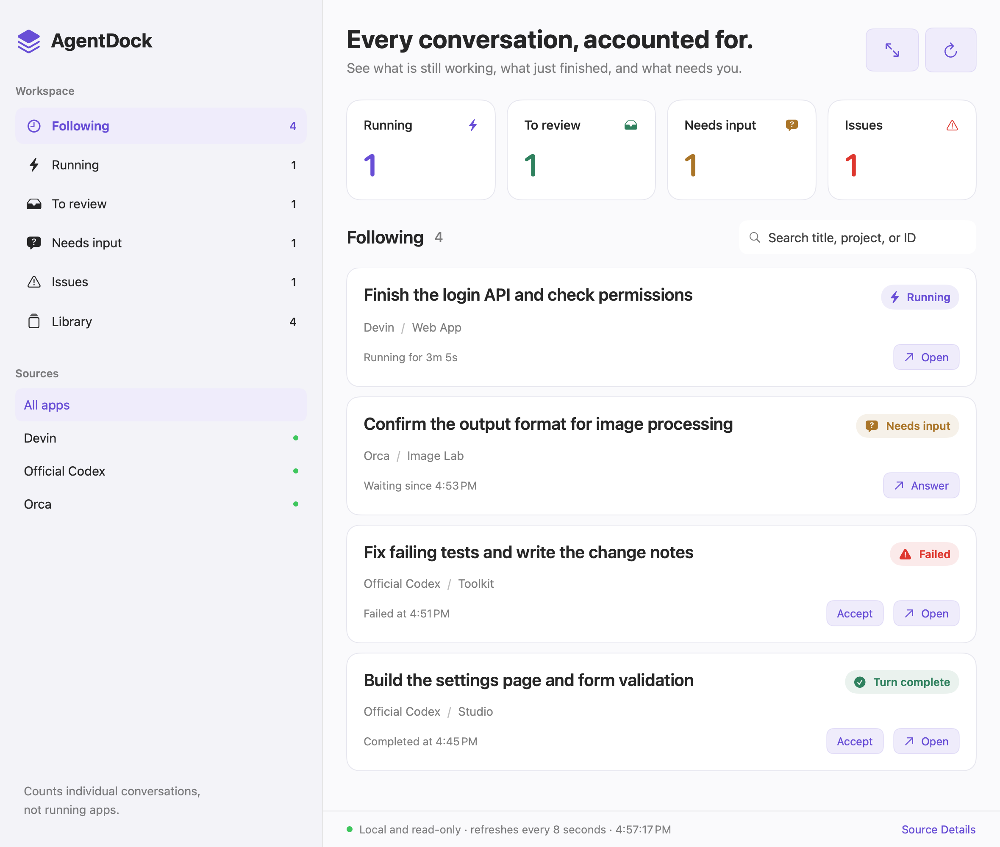

<p align="center">
  
</p>

<h1 align="center">AgentDock</h1>

<p align="center">
  <b>One window for the progress of every AI conversation.</b><br>
  With Codex, Orca, and Devin all open, see at a glance what is still running, what is done, and what is waiting for you.
</p>

<p align="center">
  <a href="https://github.com/mengziheng/AgentDock/actions/workflows/ci.yml"></a>
  
  
  <a href="LICENSE"></a>
</p>

<p align="center"><a href="README.md">简体中文</a> · English</p>

<picture>
  <source media="(prefers-color-scheme: dark)" srcset="docs/images/dashboard-en-dark.png">
  
</picture>

## Features

- **One place to look**: conversations from every app are grouped into four states and searchable by title, project, or conversation ID.
- **Notifications**: when a conversation finishes, waits for your answer, or fails, you get a system notification that opens it in one click. The Dock badge counts conversations that need input or have issues.
- **Nothing slips through**: finished conversations stay listed until you accept them; accept a whole list at once and undo a mistake.
- **Data stays on your Mac**: AgentDock reads the records each app keeps locally. No account, nothing uploaded.

| State | Meaning | What to do |
|---|---|---|
| Running | The agent is still working | Check back later |
| To review | This turn is done | Review the result and accept it |
| Needs input | The agent is waiting for you | Answer in the conversation |
| Issues | Failed, interrupted, or unclear | Open the details for the reason |

## Supported apps

| App | What it recognizes | Tested version |
|---|---|---|
| Official Codex | Desktop conversations and the status of each turn; opens the conversation directly | 26.1027.30824 |
| Orca | Agents in remote terminals, and the Codex CLI in local tabs | 1.4.243 |
| Devin | Running, needs input, finished, interrupted, and model refusals; tries to open the session | 3.12.17 |
| Other Codex-compatible apps | Same as official Codex once added to a config file ([how](docs/compatibility.md#其他兼容-codex-的应用)) | — |

Tested on macOS 26.6.2 (Apple Silicon). When Codex waits for command approval or Devin waits for tool permission, the conversation shows as Running, because neither app records these requests locally. Full details are in [compatibility and limitations](docs/compatibility.md) (Chinese).

## Install

Requires macOS 13 or later and Xcode 16 or the Command Line Tools with Swift 6.

```bash
git clone https://github.com/mengziheng/AgentDock.git
cd AgentDock
bash scripts/install-app.sh "$HOME/Applications/AgentDock.app"
open "$HOME/Applications/AgentDock.app"
```

There is no Apple-signed download yet, so install from source. Allow notifications on first launch; the UI follows the system language (English or Chinese).

<details>
<summary><b>Update and uninstall</b></summary>

**Update**: quit AgentDock, run `git pull` in the source folder, then run the install command again. Your followed conversations are kept.

**Uninstall**: quit and delete `AgentDock.app`, then remove AgentDock's local records (conversations in the source apps are not affected):

```bash
defaults delete com.local.AgentDock
rm -rf "$HOME/Library/Application Support/AgentDock"
```

</details>

<details>
<summary><b>Troubleshooting</b></summary>

- **An orange dot next to a source**: AgentDock could not read that app's data. Click Source Details in the bottom-right corner to see why.
- **A status looks wrong**: open the card; Status evidence names the record the status comes from.
- **Check what each source reports**: the command below prints conversation counts per app and state, without any conversation content.

  ```bash
  swift build -c release --product AgentDockScan && .build/release/AgentDockScan
  ```

- Still stuck? [Open an issue](https://github.com/mengziheng/AgentDock/issues) with the app versions and steps to reproduce.

</details>

## Privacy

AgentDock has no server, calls no models, and only reads local data. Its tracking records may include conversation titles and paths, and notifications show conversation titles. See [SECURITY.md](SECURITY.md) (Chinese).

## Contributing

```bash
swift build -c release
scripts/test.sh
```

Tests use fictional data only. Reports of wrong statuses and compatibility issues are welcome; see [CONTRIBUTING.md](CONTRIBUTING.md) (Chinese).

<sub>MIT License · An independent project, not affiliated with the apps or their developers. Tasks in the screenshots are fictional.</sub>
