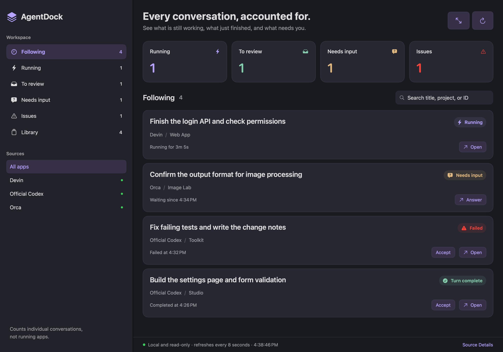

# AgentDock

[简体中文](README.md) · English

[](https://github.com/mengziheng/AgentDock/actions/workflows/ci.yml)

**One workspace for the conversations spread across your AI apps.**

When Codex, Orca, and Devin are all working on something, it is easy to lose track of which conversation is still running, which one has finished, and which one is waiting for your answer. AgentDock gathers them into one native macOS window and sends a notification when one needs you.

Local only · read-only · no account · no telemetry · English and Chinese UI · MIT licensed


<sub>Rendered from the project's own UI code with fictional tasks.</sub>

<details>
<summary>Dark mode</summary>



</details>

## What it does

- **Fewer windows to check.** See every app's conversations with their project and current status in one place, and search by title, project, or conversation ID.
- **No need to keep watching.** When a followed conversation finishes, waits for your answer, or fails, AgentDock sends a system notification; clicking it opens that conversation. The Dock badge shows how many conversations need input or have issues.
- **Unreviewed results stay put.** Conversations that are running or waiting for you are followed automatically and stay after they finish until you click Accept. You can accept a whole list at once and undo within 8 seconds.
- **Back to the source app.** Codex conversations open directly; Devin tries to open the matching session; Orca is brought to the front with the conversation title copied so you can find it.

### Four states

| State | What to do |
|---|---|
| **Running** | Let it work and check back later |
| **To review** | Check this turn's result and accept it when you are satisfied |
| **Needs input** | Go back and answer the question or make a choice |
| **Issues** | Open the details to see the error, interruption, or why the status is unclear |

Accepting only removes AgentDock's record; the original conversation is untouched. The conversation comes back when a new turn starts.

## Supported apps

| App | What AgentDock recognizes | Tested version |
|---|---|---|
| **Official Codex** (ChatGPT desktop app) | Desktop conversations, their projects, and the status of each turn | 26.1027.30824 |
| **Other Codex-compatible apps** | Same as official Codex once listed in a local config file; see the [configuration](docs/compatibility.md#其他兼容-codex-的应用) | — |
| **Orca** | Agents in remote terminals, and Codex CLI conversations in local tabs | 1.4.243 |
| **Devin** | Running, needs input, finished, interrupted, and model-provider refusals for local sessions | 3.12.17 |

Tested on macOS 26.6.2 (Apple Silicon). AgentDock reads each app's local storage, which an app update can change; if a status looks wrong, first compare your versions with this table.

**Known limitations**

- When Codex waits for you to approve a command or Devin waits for tool permission, the conversation shows as Running. Neither app writes these requests to local storage.
- Among Orca's local tabs, only those running the Codex CLI are recognized; for other agents only finished, sleeping sessions are.
- This is an experimental preview; confirm important work in the source app. The full detection rules are in [compatibility and limitations](docs/compatibility.md) (Chinese).

## Install

Requirements:

- macOS 13 or later
- Xcode 16 or later, or the Command Line Tools with Swift 6
- Python 3 (installed with the Command Line Tools)

```bash
git clone https://github.com/mengziheng/AgentDock.git
cd AgentDock
bash scripts/install-app.sh "$HOME/Applications/AgentDock.app"
open "$HOME/Applications/AgentDock.app"
```

The script builds the app from source and signs it ad hoc for this Mac; it does not add a login item. There is no Apple-signed, notarized download yet, so installing from source is the only option.

On first launch macOS asks whether AgentDock may send notifications; everything else works if you decline, and you can turn them on later in System Settings → Notifications. The UI follows the system language (English or Simplified Chinese). To open AgentDock at login, add `AgentDock.app` in System Settings → General → Login Items.

## Update

Quit AgentDock, then run in the source folder:

```bash
git pull
bash scripts/install-app.sh "$HOME/Applications/AgentDock.app"
```

Your followed and accepted conversations are kept.

## Uninstall

1. Quit AgentDock and delete `AgentDock.app`.
2. If you added a login item, remove it in System Settings → General → Login Items.
3. Delete AgentDock's own local records:

   ```bash
   defaults delete com.local.AgentDock
   rm -rf "$HOME/Library/Application Support/AgentDock"
   ```

   The first command removes the following and acceptance records; the second removes the Codex-compatible app configuration. Conversations in the source apps are not affected.

## Troubleshooting

- **An orange dot next to a source in the sidebar** means AgentDock could not read that app's data. Click Source Details in the bottom-right corner to see why; usually the app is not installed, has not been used on this Mac yet, or changed its storage format in an update.
- **A status looks wrong**: open the card and read Status evidence, which names the record the status comes from.
- **To check what each source reports**, run the following in the source folder. It scans twice, prints the timing, and lists conversation counts per app and state, without titles, paths, or message content.

  ```bash
  swift build -c release --product AgentDockScan
  .build/release/AgentDockScan
  ```

- **Still stuck?** Open an issue with the source app's version, steps to reproduce, and the output above, and remove real work content from any screenshots.

## Your data stays on this Mac

AgentDock has no backend, calls no models, and uploads no conversations or logs. It opens the source apps' databases and state files read-only and keeps its following and acceptance records on this Mac.

Those records may include conversation titles, paths, first messages, and error summaries, and notifications show conversation titles. See [local data](docs/compatibility.md#本地数据) for what is read, and [SECURITY.md](SECURITY.md) for privacy issues (both in Chinese).

## Development

```bash
swift build -c release
scripts/test.sh
```

`scripts/test.sh` runs `swift test`, adding the Swift Testing framework paths when only the Command Line Tools are installed; with Xcode, plain `swift test` works too. Tests use synthetic data only, and GitHub Actions builds and tests every push and pull request. Reports about wrong statuses, version compatibility, and usability are welcome; see [CONTRIBUTING.md](CONTRIBUTING.md) (Chinese).

[MIT License](LICENSE) · An independent project, not affiliated with or endorsed by the apps or vendors listed.
