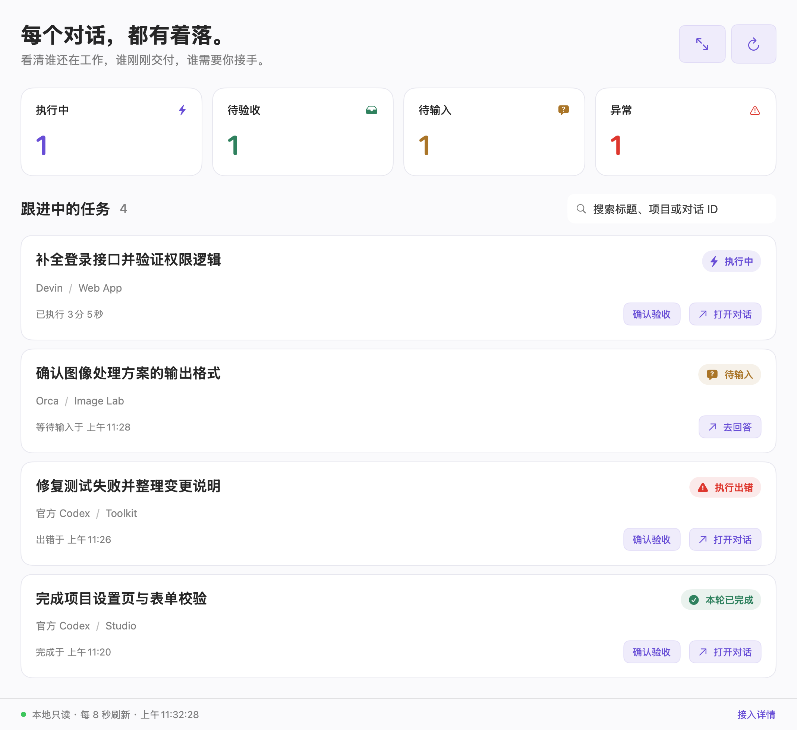
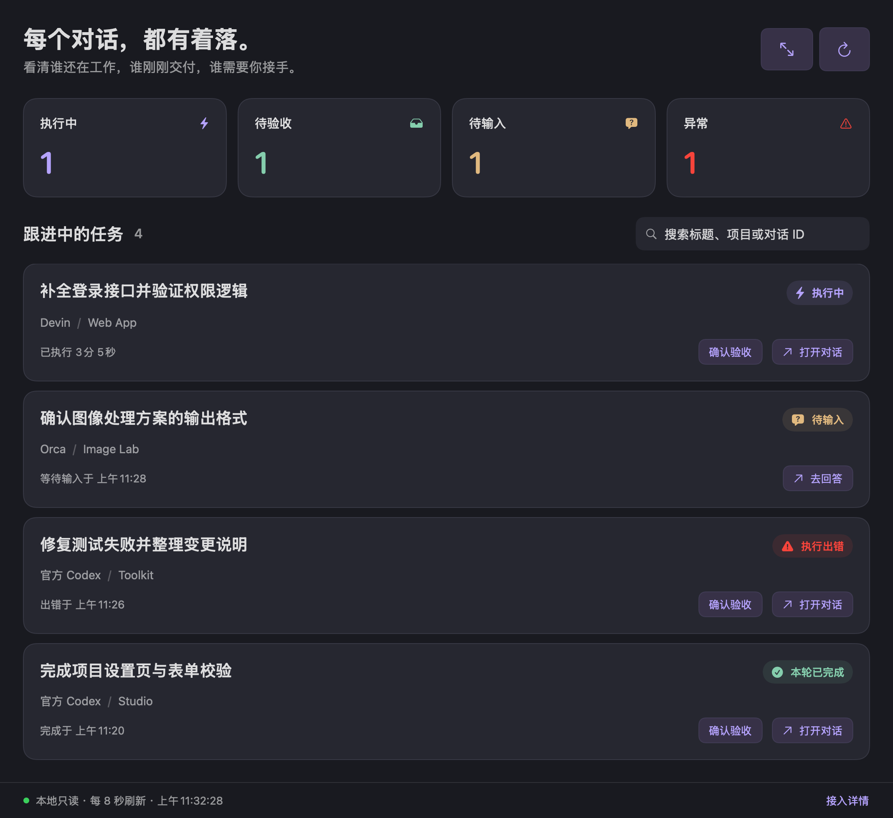

# AgentDock

**把分散在多个 AI 应用里的对话，收进一个工作台。**

同时用 Codex、Orca 和 Devin 做几件事，很容易忘记哪条对话还在跑、哪条已经交付、哪条正等你回答。AgentDock 把这些对话集中到一个原生 macOS 窗口，并在需要你处理时发出系统通知。

本地运行 · 只读扫描 · 无账号 · 无遥测 · 中英文界面 · MIT 开源

## 看起来是什么样



*界面样例使用虚构任务，由项目实际 SwiftUI 界面渲染；未使用真实对话或工作截图。展示区域为工作台主面板。*

<details>
<summary>查看深色模式</summary>



</details>

## 它能帮你做什么

- **少切几个窗口。** 在一起看各应用的对话标题、项目和当前状态，按标题、项目或对话 ID 搜索。
- **不用盯着窗口。** 跟进中的对话结束、等你回答或出错时，AgentDock 发送系统通知，点击通知直接打开该对话。Dock 图标上的数字是“待输入”和“异常”的数量之和。
- **记住还没验收的结果。** 检测到执行中或待输入的对话会自动加入跟进；结束后继续保留，直到你点击“确认验收”。可以一次验收当前列表的全部对话，误点后 8 秒内可以撤销。
- **回到原应用处理。** Codex 和 Devin 的对话可以直接跳转；Orca 会打开应用并复制对话标题，方便你查找。

### 四种状态，一眼分清

| 状态 | 你需要做什么 |
|---|---|
| **执行中** | 让它继续工作，稍后再看 |
| **待验收** | 检查本轮结果，满意后确认验收 |
| **待输入** | 回到对话，回答问题或作出选择 |
| **异常** | 打开详情，查看报错、中断或状态不确定的原因 |

“确认验收”只移除 AgentDock 的跟进记录，保留原对话。后续检测到新一轮执行时，它会重新出现。

执行中卡片上的“已执行”时间从本轮开始时算起。只要来源应用还在运行，长时间没有输出的命令也会保持“执行中”；来源应用退出或重启后仍未结束的轮次显示为“已中断”。

## 当前接入的应用

| 应用 | 接入情况 |
|---|---|
| **官方 Codex** | 读取桌面对话、项目及轮次状态，可以直接跳转到指定对话 |
| **其他兼容 Codex 的桌面应用** | 在本机配置文件中登记后接入，识别方式与官方 Codex 相同，见[配置方法](docs/compatibility.md#其他兼容-codex-的应用) |
| **Orca** | 读取本地会话与远程终端快照，识别执行、待输入及结束状态 |
| **Devin** | 读取本地会话的消息记录，识别执行中、待输入、已完成、中断和模型供应商拒绝 |

**当前为实验性预览版。** 状态识别依赖各应用的本地存储格式，应用升级可能改变格式。重要任务请结合原应用确认；“状态待确认”表示监测证据不足。完整范围见[兼容性与识别限制](docs/compatibility.md)。

## 安装

需要 **macOS 13+、Swift 6 工具链和 Python 3**。当前在 Apple Silicon 上开发验证，Intel 构建未验证；暂未提供签名、公证的下载包。

```bash
git clone https://github.com/mengziheng/AgentDock.git
cd AgentDock
bash scripts/install-app.sh "$HOME/Applications/AgentDock.app"
open "$HOME/Applications/AgentDock.app"
```

安装脚本会从源码构建并进行本机 ad-hoc 签名，不修改登录项。更新前退出 AgentDock，再运行安装命令。首次打开时 macOS 会询问是否允许通知；拒绝后其他功能照常使用，之后可在系统设置 → 通知中开启。

打开后每 8 秒自动刷新。界面语言跟随系统语言，支持简体中文和英文。需要登录启动时，可在系统设置 → 通用 → 登录项中添加 `AgentDock.app`。

## 对话数据留在本机

AgentDock 没有后端服务，不调用模型，也不会自动上传对话或日志。它只读来源应用的数据库与状态文件，把跟进和验收记录保存在本机。

这些本地记录可能包含标题、路径、首条消息和错误摘要；系统通知会显示对话标题。分享诊断信息前请先脱敏。读取位置见[本地数据说明](docs/compatibility.md#本地数据)，隐私问题见 [SECURITY.md](SECURITY.md)。

## 开发与贡献

```bash
swift build -c release
scripts/test.sh
```

`scripts/test.sh` 运行 `swift test`。只安装了 Command Line Tools 时，它会补上 Swift Testing 框架的路径；装有 Xcode 时也可以直接运行 `swift test`。测试只使用合成数据。每次推送和 Pull Request 都会在 GitHub Actions 上构建并运行测试。

欢迎反馈状态误判、应用版本兼容性和使用体验。提交 Issue 时请说明来源应用版本与复现步骤，并移除截图里的真实工作内容。参见 [CONTRIBUTING.md](CONTRIBUTING.md)。

[MIT License](LICENSE) · 非官方独立项目，与所列应用及供应商无隶属或背书关系。
